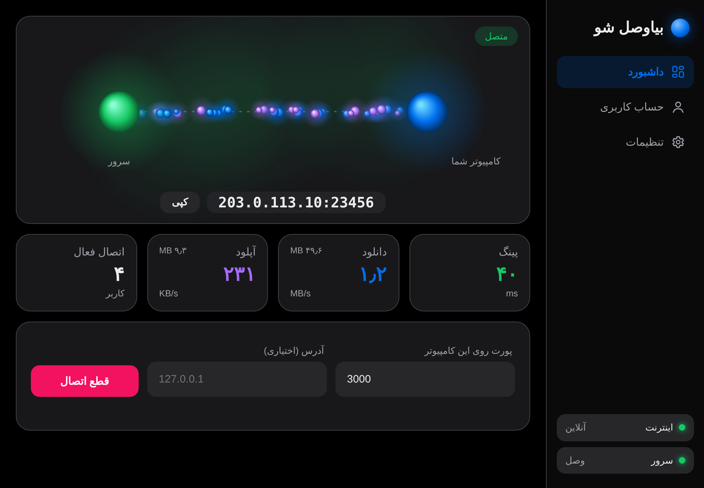
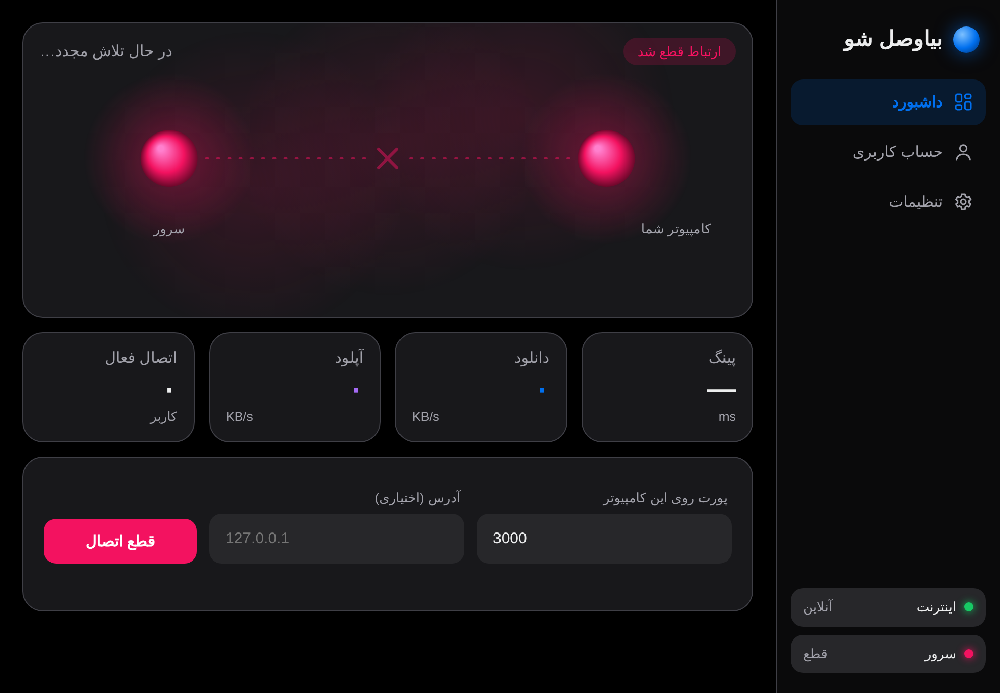
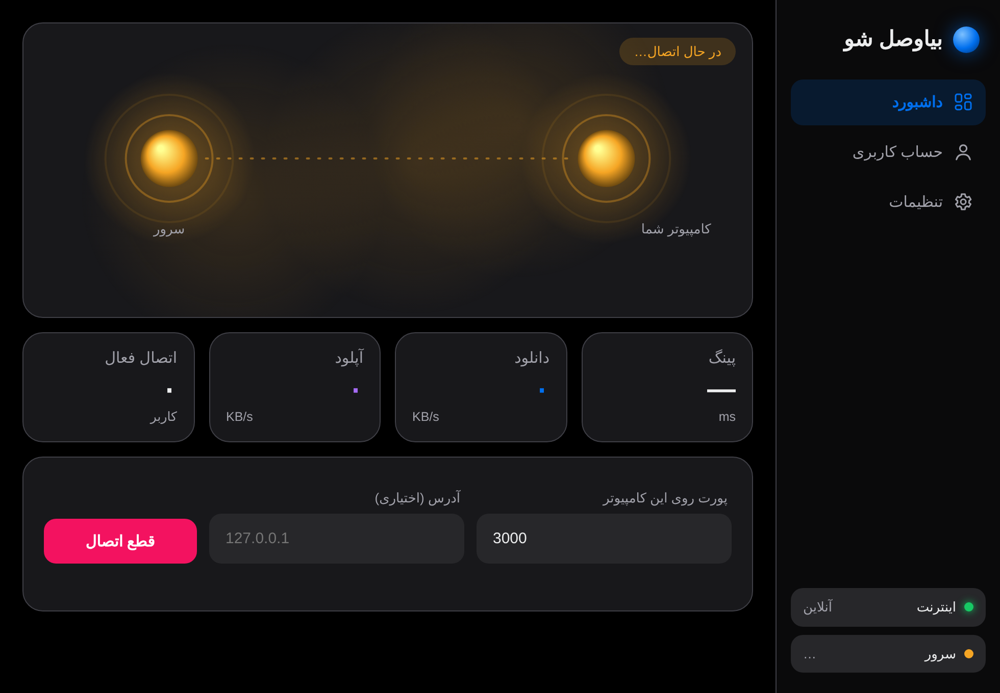
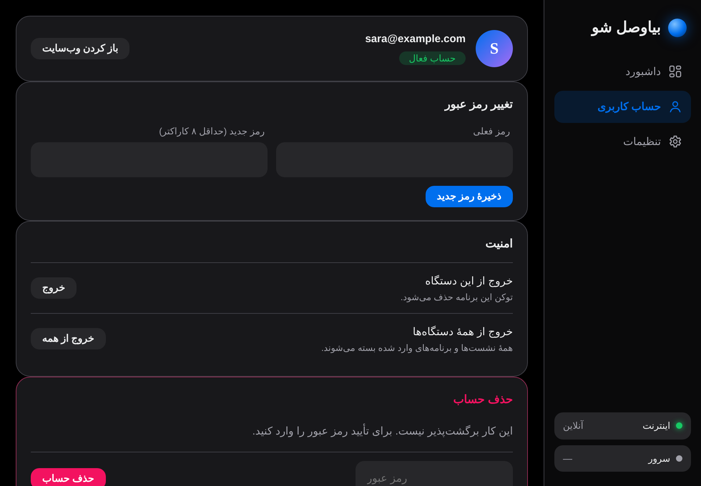
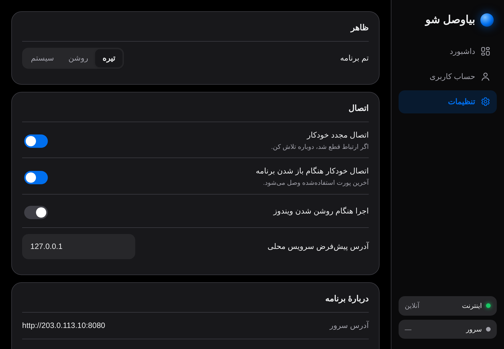
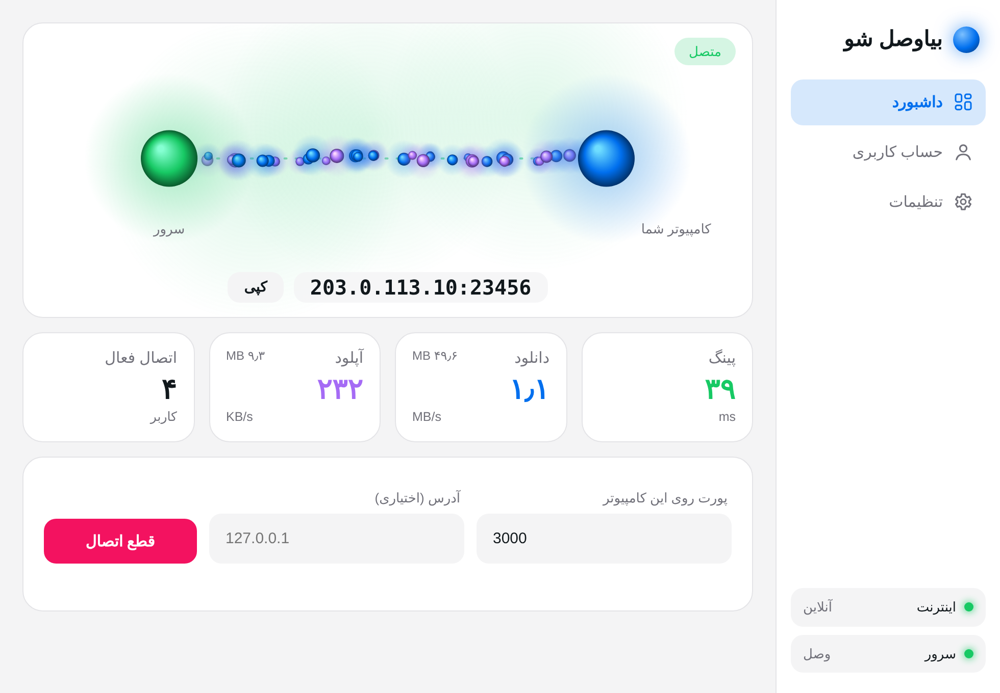

<div align="center">

# بیاوصل شو · Biavasl

**Expose a service running on your computer to the public internet — without deploying it.**

A self-hosted TCP tunnelling service with a Go control server, a Windows desktop client, and a browser-based account portal.

[](https://go.dev/)
[](https://www.electronjs.org/)
[](https://nodejs.org/)
[](https://www.microsoft.com/windows)
[](#license)

<p>
  
</p>

[فارسی](#فارسی) · [Features](#features) · [Architecture](#architecture) · [Installation](#installation) · [API reference](#http-api-reference) · [Troubleshooting](#troubleshooting)

</div>

---

## Overview

Biavasl (بیاوصل شو) lets you publish a TCP service from your own computer through a server you control. Run a development server, dashboard, game server, webhook receiver, or another TCP-based service locally; Biavasl assigns a public port on your VPS and forwards incoming connections to the selected local host and port.

The project consists of:

- **Go server** — account API, browser portal, token authentication, and public TCP tunnel listeners.
- **Electron desktop app** — Windows GUI for authentication, tunnel management, traffic statistics, and preferences.
- **Browser account portal** — sign-up, sign-in, password management, session revocation, and account deletion.

> **Important:** Biavasl is a TCP port-forwarding tunnel, not a VPN, HTTP reverse proxy, domain manager, or hosting platform. It exposes the selected local TCP service to anyone who can reach the public host and assigned port. Protect the service you expose.

## Features

- Publish a local TCP port through a public VPS.
- Automatically allocate a public port, or request a preferred port in the supported range.
- Browser-based sign-up and sign-in, with automatic return to the desktop app.
- Per-user desktop bearer tokens and browser sessions.
- Password change, sign out, sign out everywhere, and account deletion.
- Automatic reconnection with exponential backoff.
- Live round-trip latency, upload/download rates, transferred totals, and active-connection count.
- Dark, light, and system theme options.
- Optional reconnect, connect-on-launch, and launch-on-Windows-login settings.
- Token storage using Electron `safeStorage` when the operating system provides encryption.
- Self-hosted web portal and embedded web assets; no third-party Go dependencies.

## Screenshots

The repository includes these application screenshots:

| Dashboard — connected | Dashboard — disconnected |
|---|---|
|  |  |

| Connecting | Account |
|---|---|
|  |  |

| Settings | Light theme |
|---|---|
|  |  |

---

## Architecture

```text
                         PUBLIC INTERNET
                                |
                    +-----------v-----------+
                    |      Biavasl VPS      |
                    |                       |
 Browser ---------->| HTTPS reverse proxy   |----> Go HTTP server :8080
                    |                       |      - Account API
 Desktop browser -->| /connect              |      - Account portal
                    |                       |
                    | Go TCP control :7000  |<---- Desktop control connection
                    |                       |
 Visitor ---------->| Public TCP :20000-40000
                    +-----------+-----------+
                                |
                     authenticated tunnel
                                |
                    +-----------v-----------+
                    |   Biavasl Desktop     |
                    |   Electron + Node     |
                    |                       |
                    | Local TCP connection  |----> 127.0.0.1:LOCAL_PORT
                    +-----------------------+
```

### Connection lifecycle

1. The desktop app starts a temporary HTTP callback server bound to `127.0.0.1` and opens the configured Biavasl website.
2. The user signs in or creates an account in the browser.
3. The portal calls `POST /api/authorize` and returns a random bearer token (the current implementation does not set a token expiry) to the local callback. The callback validates a random `state` value.
4. The desktop app retrieves the public host and control port from `GET /api/info`, then stores the token using Electron `safeStorage` where available.
5. When a tunnel starts, the app opens a TCP control connection and sends an `auth` message containing its token and optional preferred public port.
6. The server validates the token, allocates a public TCP listener, and responds with `ready`.
7. For each visitor, the server notifies the desktop app with a `conn` message. The desktop opens a local TCP connection and a second server connection; the two sockets are piped together.
8. The client sends a ping every five seconds. The server responds with a pong, allowing the app to display round-trip latency.

### Limits and defaults

| Setting | Value |
|---|---:|
| Automatically allocated public ports | `20000–40000` |
| Maximum simultaneous tunnels per account | `5` |
| Control keepalive | 30 seconds |
| Client ping interval | 5 seconds |
| Client reconnect backoff | 1–15 seconds |
| Visitor hand-off timeout | 10 seconds |
| Server ping read timeout | 60 seconds |
| Minimum account password length | 8 characters |
| Password hashing | PBKDF2-HMAC-SHA-256, 200,000 iterations, 32-byte key |
| Account database | Single JSON file (default `data.json`) |

The server's requested-port logic accepts a preferred port only when it is in `20000–40000` and available. Otherwise it tries to allocate a random available port in that range.

---

## Repository layout

```text
biavasl/
├── app/                       # Electron desktop client
│   ├── assets/fonts/           # Optional desktop font
│   ├── config.js               # Server URL configuration
│   ├── index.html              # Desktop UI
│   ├── main.js                 # Electron main process and IPC handlers
│   ├── preload.js              # Context-isolated API bridge
│   ├── renderer.js             # UI state and interactions
│   ├── orbs.js                 # Canvas connection/traffic animation
│   ├── tunnel.js               # TCP tunnel client and traffic counters
│   ├── style.css               # Desktop styles
│   └── package.json            # Electron dependencies and build scripts
├── server/
│   ├── main.go                 # HTTP API, account storage, TCP tunnel server
│   ├── go.mod                  # Go module (Go 1.24)
│   └── web/
│       ├── index.html          # Persian account portal
│       └── fonts/              # Optional web font
├── screenshots/
└── README.md
```

---

# Installation

There are two components to install:

1. **Server:** deploy this on a public Linux VPS (recommended). It can also run on Windows or macOS for development/testing.
2. **Desktop client:** the current `electron-builder` configuration produces a Windows NSIS installer. The Electron app can be run from source on Windows, macOS, and Linux, but packaged installers for macOS/Linux are not configured in this repository.

## 1. Requirements

### Server

- Go **1.24 or newer**.
- A machine with a public IPv4 address or a DNS name pointing to it.
- Permission to listen on the HTTP, control, and public tunnel port ranges.
- Firewall access to TCP `8080`, `7000`, and `20000–40000` (or your configured equivalents).
- A persistent writable directory for the JSON database.
- Recommended for production: a domain name and HTTPS reverse proxy (Caddy or Nginx).

### Desktop client

- Node.js 20 LTS or newer (Node.js 22 LTS is also suitable).
- npm.
- Windows 10/11 for the supported packaged installer.
- A running Biavasl server reachable from the desktop computer.

---

## 2. Deploy the server on Linux (Ubuntu/Debian)

The following example uses Ubuntu 22.04/24.04 or Debian with a dedicated `/opt/biavasl` directory.

### Install Go

Install Go 1.24 or newer from the official downloads page: <https://go.dev/dl/>.

Verify:

```bash
go version
# go version go1.24.x ...
```

If your distribution's package manager provides an older Go release, use the official Go tarball instead.

### Get the source

Clone your repository or upload the project:

```bash
git clone https://github.com/YOUR_USERNAME/biavasl.git
cd biavasl
```

### Build

```bash
cd server
go build -trimpath -ldflags="-s -w" -o biavasl-server .
```

The server uses only the Go standard library. No `go get` or third-party Go modules are required.

### Configure the public host

`PUBLIC_HOST` must be the public IP address or DNS hostname visitors should use to reach allocated tunnel ports. Do not include a scheme or port.

```bash
export PUBLIC_HOST="tunnel.example.com"
```

### Run

```bash
./biavasl-server \
  -http ":8080" \
  -control ":7000" \
  -db "/opt/biavasl/data.json"
```

The HTTP portal/API listens on `:8080`; the tunnel control listener listens on `:7000`. Public visitor listeners are allocated in `20000–40000`.

For a quick test, you can use the public IP instead:

```bash
PUBLIC_HOST="203.0.113.10" ./biavasl-server \
  -http ":8080" -control ":7000" -db "./data.json"
```

Replace the example IP with your actual server IP.

### Open the firewall

For UFW:

```bash
sudo ufw allow 8080/tcp
sudo ufw allow 7000/tcp
sudo ufw allow 20000:40000/tcp
sudo ufw status
```

Also configure the VPS provider's cloud firewall/security group to allow the same inbound TCP ports. Opening only UFW is insufficient if the provider firewall blocks traffic.

### Run as a systemd service

Create a dedicated service account and installation directory:

```bash
sudo useradd --system --home /opt/biavasl --shell /usr/sbin/nologin biavasl
sudo mkdir -p /opt/biavasl
sudo cp biavasl-server /opt/biavasl/
sudo chown -R biavasl:biavasl /opt/biavasl
sudo chmod 750 /opt/biavasl
```

Create `/etc/biavasl.env`:

```ini
PUBLIC_HOST=tunnel.example.com
```

Protect it:

```bash
sudo chown root:biavasl /etc/biavasl.env
sudo chmod 640 /etc/biavasl.env
```

Create `/etc/systemd/system/biavasl.service`:

```ini
[Unit]
Description=Biavasl tunnel server
After=network-online.target
Wants=network-online.target

[Service]
Type=simple
User=biavasl
Group=biavasl
WorkingDirectory=/opt/biavasl
EnvironmentFile=/etc/biavasl.env
ExecStart=/opt/biavasl/biavasl-server -http :8080 -control :7000 -db /opt/biavasl/data.json
Restart=always
RestartSec=3
NoNewPrivileges=true
PrivateTmp=true
ProtectSystem=strict
ReadWritePaths=/opt/biavasl

[Install]
WantedBy=multi-user.target
```

Enable and start:

```bash
sudo systemctl daemon-reload
sudo systemctl enable --now biavasl
sudo systemctl status biavasl
```

Follow logs:

```bash
sudo journalctl -u biavasl -f
```

The database file is created when the first account/session is written. Ensure the service user can write to `/opt/biavasl`.

---

## 3. HTTPS with Caddy (recommended)

The Go server does **not** terminate TLS itself. Put an HTTPS reverse proxy in front of the HTTP portal/API. The raw TCP control and allocated visitor ports are separate TCP services and must remain reachable directly.

Example `/etc/caddy/Caddyfile`:

```caddy
tunnel.example.com {
    reverse_proxy 127.0.0.1:8080
}
```

Then:

```bash
sudo systemctl reload caddy
```

Caddy obtains and renews certificates automatically when DNS and ports 80/443 are correctly configured.

Keep the Go server's HTTP listener private to the machine when using a reverse proxy (for example, change `-http :8080` to `-http 127.0.0.1:8080`). The desktop `SERVER_URL` should use the public HTTPS URL.

**Important:** `PUBLIC_HOST` is the hostname/IP displayed to tunnel visitors. It is not necessarily the hostname used for the account website, although using the same domain is possible if DNS and routing are configured appropriately.

## 4. HTTPS with Nginx (alternative)

Example server block:

```nginx
server {
    listen 80;
    server_name tunnel.example.com;

    location / {
        proxy_pass http://127.0.0.1:8080;
        proxy_http_version 1.1;
        proxy_set_header Host $host;
        proxy_set_header X-Real-IP $remote_addr;
        proxy_set_header X-Forwarded-For $proxy_add_x_forwarded_for;
        proxy_set_header X-Forwarded-Proto $scheme;
    }
}
```

After configuring TLS with Certbot, retain the `X-Forwarded-Proto` header. The application uses it to mark the browser session cookie as `Secure`.

The control listener (`7000/tcp`) and visitor port range (`20000–40000/tcp`) are not HTTP and must **not** be proxied through this HTTP server block.

---

## 5. Run the server on Windows

1. Install Go 1.24+: <https://go.dev/dl/>.
2. Open PowerShell in the repository.
3. Build the server:

```powershell
cd server
go build -o biavasl-server.exe .
```

4. Set the public host and run:

```powershell
$env:PUBLIC_HOST = "YOUR_PUBLIC_IP_OR_DOMAIN"
.\biavasl-server.exe -http ":8080" -control ":7000" -db ".\data.json"
```

Allow inbound TCP `8080`, `7000`, and `20000–40000` in Windows Defender Firewall and in your cloud firewall.

For a local-only development test, use a reachable public host only if external clients need to connect. `localhost` is not a valid public host for remote visitors.

## 6. Run the server on macOS

1. Install Go 1.24+ from <https://go.dev/dl/> or your preferred package manager.
2. In Terminal:

```bash
cd server
go build -o biavasl-server .
PUBLIC_HOST="YOUR_PUBLIC_IP_OR_DOMAIN" ./biavasl-server \
  -http ":8080" -control ":7000" -db "./data.json"
```

Allow the three TCP port groups in the host/network firewall. For production, a public VPS is generally a better location for the server than a personal Mac behind NAT.

---

## 7. Configure and run the desktop app

The desktop client must know the public URL of the server's account website.

Edit `app/config.js`:

```js
module.exports = {
  SERVER_URL: "https://tunnel.example.com"
};
```

Use the base URL only: no `/api` suffix and no trailing route is required. For a direct HTTP development server, for example:

```js
module.exports = {
  SERVER_URL: "http://203.0.113.10:8080"
};
```

Install dependencies and launch:

```bash
cd app
npm install
npm start
```

The first launch opens the desktop UI. Select **Sign in with browser**, create an account or sign in, and return to the app.

### Optional font

The UI includes system-font fallbacks. To use Yekan Bakh, place the font file at:

- Desktop: `app/assets/fonts/yekanbakh2.woff2`
- Server portal: `server/web/fonts/yekanbakh2.woff2`

The repository intentionally does not include the font. Make sure you have the right to distribute it before bundling it.

### Build the Windows installer

On Windows:

```powershell
cd app
npm install
npm run build
```

The configured `electron-builder` target is NSIS. The generated installer is placed in `app/dist/` by electron-builder.

### Run the Electron app on macOS or Linux

The source app uses Electron and Node TCP sockets and can be launched for development on those platforms:

```bash
cd app
npm install
npm start
```

However, the current package configuration only defines a Windows installer target. macOS signing/notarization and Linux packaging targets have not been configured or tested in this repository.

---

# Configuration reference

## Server command-line flags

| Flag | Default | Description |
|---|---|---|
| `-http` | `:8080` | HTTP website/API listen address |
| `-control` | `:7000` | Raw TCP tunnel control listen address |
| `-db` | `data.json` | Path to the JSON account/token/session database |

### Required environment variable

| Variable | Required | Description |
|---|---|---|
| `PUBLIC_HOST` | Yes | Public IP or hostname returned by `/api/info` and used in tunnel addresses |

Example:

```bash
PUBLIC_HOST="tunnel.example.com" ./biavasl-server \
  -http "127.0.0.1:8080" \
  -control ":7000" \
  -db "/var/lib/biavasl/data.json"
```

If the control address uses a non-default port, that port is returned by `/api/info` and used by the desktop app automatically.

## Desktop configuration

| Setting | Default | Description |
|---|---|---|
| `SERVER_URL` in `config.js` | `http://YOUR_SERVER_IP:8080` | Base URL of the website/API |
| Theme | `dark` | `dark`, `light`, or `system` |
| `reconnect` | `true` | Retry after an unexpected control-connection loss |
| `autoConnect` | `false` | Reconnect to the last local port when the app opens |
| `autoStart` | `false` | Launch the app at Windows login |
| `localHost` | `127.0.0.1` | Default local service host |
| `lastPort` | empty | Last local TCP port used |
| `want` | `0` | Last assigned public port; reset when the local port changes |

Desktop settings are stored in Electron's user-data directory in `settings.json`. The login token is stored separately in `session.bin`.

---

# HTTP API reference

All API endpoints are served by the Go server under `/api`. Request and response bodies use JSON unless noted otherwise. The account portal and API share the same origin.

## Public endpoints

### `GET /api/info`

Returns the public tunnel hostname and TCP control port. Used by the desktop client after browser authorization.

**Response — `200 OK`**

```json
{
  "host": "tunnel.example.com",
  "control_port": "7000"
}
```

### `POST /api/signup`

Creates an account and signs the browser in immediately.

**Request**

```json
{
  "email": "user@example.com",
  "password": "a-strong-password"
}
```

**Success — `200 OK`**

```json
{
  "email": "user@example.com"
}
```

**Errors**

- `400 Bad Request` — malformed JSON, invalid email, or password shorter than 8 characters.
- `409 Conflict` — email is already registered.

### `POST /api/signin`

Authenticates an existing account and creates a browser session.

**Request**

```json
{
  "email": "user@example.com",
  "password": "a-strong-password"
}
```

**Success — `200 OK`**

```json
{
  "email": "user@example.com"
}
```

**Errors**

- `400 Bad Request` — malformed request or invalid email.
- `401 Unauthorized` — incorrect email/password.

### `GET /api/me`

Returns the authenticated account email. Accepts either the browser `sid` cookie or a desktop bearer token.

**Success — `200 OK`**

```json
{
  "email": "user@example.com"
}
```

**Unauthenticated — `401 Unauthorized`**

```json
{
  "error": "وارد نشده‌اید"
}
```

## Authenticated endpoints

Authentication is accepted in either of these forms:

- Browser: the `sid` cookie set by sign-in/sign-up.
- Desktop/API client: `Authorization: Bearer YOUR_TOKEN`.

### `POST /api/signout`

Deletes the current browser session and expires the `sid` cookie.

**Success — `200 OK`**

```json
{
  "ok": true
}
```

This endpoint removes the browser session only. It does not revoke desktop bearer tokens. Use `/api/revoke-all` to invalidate all sessions and app tokens for the account.

### `POST /api/password`

Changes the authenticated user's password.

**Request**

```json
{
  "old": "current-password",
  "new": "new-password-123"
}
```

**Success — `200 OK`**

```json
{
  "ok": true
}
```

**Errors**

- `400 Bad Request` — malformed JSON or new password shorter than 8 characters.
- `401 Unauthorized` — no valid session/token.
- `403 Forbidden` — current password is incorrect.

Changing the password does not automatically revoke existing sessions or desktop tokens.

### `POST /api/revoke-all`

Invalidates all browser sessions and desktop tokens belonging to the authenticated account, then expires the current browser cookie.

**Success — `200 OK`**

```json
{
  "ok": true
}
```

**Error:** `401 Unauthorized` if not authenticated.

### `POST /api/delete-account`

Permanently deletes the authenticated account and revokes its sessions and desktop tokens.

**Request**

```json
{
  "password": "current-password"
}
```

**Success — `200 OK`**

```json
{
  "ok": true
}
```

**Errors**

- `401 Unauthorized` — no valid session/token.
- `403 Forbidden` — password is incorrect.

### `POST /api/authorize`

Mints a desktop bearer token for the currently authenticated **browser session**. This endpoint intentionally does not accept a bearer token; it is called by the browser portal after sign-in during desktop login.

**Request:** empty JSON object `{}`.

**Success — `200 OK`**

```json
{
  "token": "RANDOM_TOKEN",
  "email": "user@example.com"
}
```

**Error:** `401 Unauthorized` if the browser session is not authenticated.

The token is random and the database stores its SHA-256 hash rather than the raw token.

## Web pages and static assets

| Method | Path | Purpose |
|---|---|---|
| `GET` | `/` | Browser account portal |
| `GET` | `/connect` | Same portal, with desktop callback parameters supported |
| `GET` | `/fonts/...` | Embedded web font/static font assets |
| `GET` | `/api/info` | Public server information |
| `GET` | `/api/me` | Current account |
| `POST` | `/api/signup` | Create account |
| `POST` | `/api/signin` | Sign in |
| `POST` | `/api/signout` | Sign out current browser session |
| `POST` | `/api/password` | Change password |
| `POST` | `/api/revoke-all` | Revoke all sessions and tokens |
| `POST` | `/api/delete-account` | Delete account |
| `POST` | `/api/authorize` | Mint desktop token |

There is no REST endpoint for creating or managing tunnels. Tunnel traffic uses the raw TCP control protocol described below.

---

# TCP tunnel protocol

The control protocol is newline-delimited JSON over TCP. The desktop client connects to the server's control port (default `7000`).

## Client → server messages

### Authenticate and request a tunnel

```json
{"type":"auth","token":"DESKTOP_BEARER_TOKEN","want":25000}
```

- `type`: `auth`
- `token`: bearer token obtained from `/api/authorize`
- `want`: preferred public port; use `0` for automatic allocation

### Keepalive / latency probe

```json
{"type":"ping","t":1730000000000}
```

`t` is the client timestamp in Unix milliseconds. The server echoes it in a `pong`.

## Server → client messages

### Tunnel ready

```json
{"type":"ready","host":"tunnel.example.com","port":25000}
```

### Visitor connected

```json
{"type":"conn","id":"CONNECTION_ID"}
```

The client opens a local TCP connection and a second TCP connection to the control port, then sends the data-channel preamble:

```json
{"type":"data","id":"CONNECTION_ID"}
```

After the newline, the remainder of that TCP stream is raw bidirectional application data.

### Ping response

```json
{"type":"pong","t":1730000000000}
```

### Error

```json
{"type":"error","error":"unauthorized"}
```

Known error values:

| Error | Meaning |
|---|---|
| `unauthorized` | Bearer token is invalid or revoked |
| `too_many_tunnels` | Account already has the maximum number of active tunnels |
| `no_free_port` | Server could not bind a public port in the allocation range |

---

# Example: expose a local service

Suppose your local web application listens on `127.0.0.1:3000`.

1. Start your local application and verify it works at `http://127.0.0.1:3000`.
2. Open Biavasl and sign in.
3. Enter `3000` as the local port.
4. Keep the local host as `127.0.0.1`.
5. Click **Connect**.
6. Wait for the app to show the public address, for example `tunnel.example.com:25000`.
7. Visit the public address from another network or device.

For an HTTP service, open `http://tunnel.example.com:25000` in the browser. The tunnel itself is TCP; the HTTP protocol is provided by your local application.

---

# Security and production considerations

Biavasl handles account credentials and exposes arbitrary local TCP services. Review these points before operating it for real users:

- **Use HTTPS for the website/API.** The Go HTTP server is plain HTTP. Put Caddy/Nginx or another TLS reverse proxy in front of it.
- **Keep the HTTP origin private.** When using a reverse proxy, bind the Go HTTP listener to `127.0.0.1` so clients cannot bypass TLS.
- **Protect the control port and public port range.** Only expose the required TCP ports. The control port is authenticated, but the visitor ports are public by design.
- **Assume a tunnel is public.** Anyone who discovers or receives the assigned host and port can connect. Add authentication to the local service where appropriate.
- **Back up `data.json`.** It contains password hashes, token hashes, and session hashes. Do not publish it or commit it to Git.
- **Restrict filesystem permissions.** The server database should be readable/writable only by the service account.
- **Use strong unique passwords.** The current implementation enforces a minimum of eight characters.
- **Understand token lifetime.** Desktop tokens currently have no expiry timestamp; revoke them with `/api/revoke-all` or delete the account.
- **Plan for JSON storage limits.** The current database is a single JSON file rewritten on updates. It is suitable for a small/self-hosted deployment, not a high-write, horizontally scaled production service.
- **Add operational controls before public multi-user deployment.** The current code does not implement account rate limiting, email verification, password-reset flow, per-user bandwidth quotas, or an administrator panel.
- **Use a trusted network path.** The raw TCP control/data channels are not encrypted by the application protocol. Deploy them behind a trusted network or add transport encryption before using untrusted networks.
- **Review reverse-proxy behavior.** The browser cookie is marked Secure when the request has TLS or `X-Forwarded-Proto: https`. Ensure the proxy sets this header correctly.

These are implementation characteristics, not guarantees that the application is hardened for every production threat model.

---

# Troubleshooting

### The desktop app says the server is unavailable

- Check `SERVER_URL` in `app/config.js`.
- Confirm the website is reachable from the desktop computer.
- Check the Go server and reverse-proxy logs.
- Confirm `/api/info` returns valid JSON:

```bash
curl -i https://tunnel.example.com/api/info
```

### Login completes in the browser but the desktop app does not connect

- Allow the browser to open the local callback URL.
- Check that local security software is not blocking the temporary `127.0.0.1` callback listener.
- Confirm `/api/authorize` is reachable through the same `SERVER_URL`.
- Check that the control port reported by `/api/info` is reachable from the desktop computer.

### The tunnel connects but visitors cannot reach it

- Confirm the local service is listening on the configured local host and port.
- If the service listens only on a different interface, change the local host in the desktop app.
- Open TCP `20000–40000` in both the server OS firewall and VPS provider firewall.
- Confirm `PUBLIC_HOST` resolves to the VPS public IP.
- Check that another process or firewall is not blocking the assigned port.

### `no_free_port`

- Check that the server can bind to ports `20000–40000`.
- Confirm the range is not already occupied by another service.
- Check the server logs for bind errors.

### `too_many_tunnels`

The current server limit is five active tunnels per account. Stop an existing tunnel before starting another.

### Font does not load

Check the exact filename and path: `yekanbakh2.woff2`. The font is optional; the UI uses fallback fonts if it is absent.

### Go reports an unsupported package or missing `crypto/pbkdf2`

Use Go 1.24 or newer and verify the `go` executable on your `PATH` is the expected version.

---

# Development

## Server

```bash
cd server
go test ./...
go build ./...
```

There are currently no external Go module dependencies and no test files included in the repository.

## Desktop app

```bash
cd app
npm install
npm start
```

The project currently has no automated test or lint scripts defined in `package.json`.

## Suggested production improvements

Potential next steps for maintainers:

- Replace JSON-file storage with SQLite or PostgreSQL and add schema migrations.
- Add rate limiting and abuse protection to account endpoints.
- Add token expiry, token rotation, and device/session management.
- Add encrypted transport for control and data connections.
- Add per-user tunnel, bandwidth, and connection quotas.
- Add structured logging, metrics, health checks, and graceful shutdown.
- Add integration tests for authentication, tunnel allocation, reconnects, and concurrent visitors.
- Add Linux/macOS desktop packaging and automated release workflows.
- Add a LICENSE file and contribution guidelines before accepting external contributions.

---

# License

No license file is currently included. Unless a license is added to this repository, all rights are reserved by the copyright holder. Do not assume that the code may be redistributed, modified, or used commercially.

---

# فارسی

**بیاوصل شو** ابزاری خودمیزبان برای اتصال سرویس‌های TCP کامپیوتر شما به اینترنت است. برنامه روی کامپیوتر اجرا می‌شود، به سرور عمومی شما متصل می‌شود و برای سرویس محلی‌تان یک پورت عمومی دریافت می‌کند.

اجزای پروژه:

- **سرور Go:** مدیریت حساب‌ها، API، پنل ورود و ثبت‌نام و تونل‌های TCP.
- **برنامه دسکتاپ Electron:** ورود با مرورگر، ساخت و مدیریت تونل، نمایش پینگ و آمار ترافیک.
- **پنل وب:** ثبت‌نام، ورود، تغییر رمز، خروج از همهٔ دستگاه‌ها و حذف حساب.

### نصب سریع سرور در لینوکس

```bash
cd server
go build -o biavasl-server .
PUBLIC_HOST="IP_OR_DOMAIN" ./biavasl-server \
  -http ":8080" -control ":7000" -db "./data.json"
```

پورت‌های TCP زیر باید در فایروال سرور و پنل ارائه‌دهندهٔ VPS باز باشند:

- `8080/tcp` برای وب‌سایت و API
- `7000/tcp` برای ارتباط کنترلی برنامه
- `20000–40000/tcp` برای اتصال کاربران به تونل‌ها

برای استفادهٔ واقعی، وب‌سایت را پشت HTTPS با Caddy یا Nginx قرار دهید.

### اجرای برنامه دسکتاپ

در فایل `app/config.js` آدرس سرور را تنظیم کنید:

```js
module.exports = {
  SERVER_URL: "https://tunnel.example.com"
};
```

سپس:

```bash
cd app
npm install
npm start
```

برای ساخت نصب‌کنندهٔ ویندوز:

```bash
npm run build
```

راهنمای کامل API، پروتکل TCP، تنظیمات، نصب در سیستم‌عامل‌های مختلف و نکات امنیتی در بخش‌های انگلیسی همین README آمده است.

---

<div align="center">

**Built for self-hosted TCP tunnelling.**

</div>
